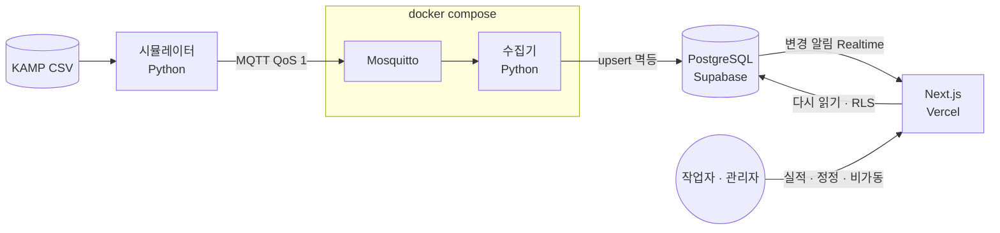

# ShotTrace

[](https://github.com/parkbeomjun664/ShotTrace/actions/workflows/ci.yml)

> 사출성형 공장의 생산 실적과 품질 이력을 관리하는 MES.
> **LOT과 설비 상태를 시간 구간으로 잇는 것**이 이 시스템의 핵심이다.

제조 IT 22년 경력자 인터뷰로 요구사항을 도출했고, KAMP 공개 실데이터(사출성형기 부품 5,232개 = 샷 2,626번 × 공정변수 24개)를
시간축으로 재생해 사용한다. ISA-95 Level 3에 해당한다.

**배포** — https://shot-trace.vercel.app · 둘러보기 계정 `viewer@example.com` / `parkbeomjun122!!` (읽기 전용)
**현재 상태** — 기능 완성 단계 · 2026-08 시작 · **2026-11 완성 목표**

| | |
|---|---|
| 화면 | 현황판(실시간) · LOT 추적(+ **LLM 대응 가이드**) · 품질 · **OEE** · 실적 입력/정정 · 비가동 · 마스터 |
| 데이터베이스 | PostgreSQL 마이그레이션 23개 · 표 12 · View 6 · RPC 2 · RLS 역할 3 |
| 검증 | 자동 테스트 25 (Vitest 11 · pytest 12 · Playwright 2) · CI · 제약 실험 13/13 · RLS 전수 점검 |
| 설계 기록 | [ADR 17개](docs/decisions/) — 결정마다 **버린 대안** 포함 |

**한 문장 · 30초 · 5분 설명** — [`docs/설명.md`](docs/설명.md)

---

## 왜 시간 구간 조인인가

현장에서 추적하는 목적은 자재가 아니라 **"그 LOT을 만들 때 설비가 어땠나"**이다. 인터뷰에서 이 얘기를 듣고 설계를 바꿨다.

그래서 설비가 보내는 샷(`shot`)에는 `lot_id` 가 **없다.** `equipment_id` 와 `measured_at` 만 갖고, LOT 조회는 항상 시간 범위로 조인한다.
설비는 지금 어떤 LOT 을 만드는지 모르기 때문이다([ADR 001](docs/decisions/001-시간구간-조인-구조.md)).

```sql
-- LOT 하나를 클릭하면 이 쿼리가 돈다
SELECT s.*, sp.pass_or_fail, sp.fail_reason
FROM   production_lot l
JOIN   shot s       ON s.equipment_id = l.equip_cd
                   AND s.measured_at >= l.started_at    -- 반열린 구간 [시작, 끝)
                   AND s.measured_at <  l.ended_at
JOIN   shot_part sp ON sp.equipment_id = s.equipment_id
                   AND sp.measured_at  = s.measured_at
                   AND sp.product_id   = l.product_id
WHERE  l.lot_id = :lot_id
ORDER  BY s.measured_at;
```

24개 공정변수와 불량 여부 · 사유가 이 한 번의 시간 범위 조회로 나온다. **불량이 언제 났고 그 직전 온도 · 압력이 어땠는지**가 붙는다.

- **현장 MES 와의 차이** — 현장은 "지금 이 설비가 하는 작업" 에 신호를 **쓸 때 묶는다**. 이 프로젝트는 **읽을 때 잇는다** —
  늦게 온 신호와 LOT 경계 수정에 강한 대신 조인 비용을 인덱스로 감당한다
- **인덱스** — 10배 데이터에서 LOT 하나 조회 0.47 ms, 인덱스를 끄면 13.8 ms (차이 4.5배 → 30배) — [evidence/perf-10x](docs/evidence/perf-10x.md)
- **패밀리 금형** — S14 는 한 샷에 LH · RH 두 부품을 찍는다. 공정변수는 샷의 속성, 품질은 부품의 속성이라 표를 나눴다([ADR 005](docs/decisions/005-샷과-부품-분리.md))
- **겹침 금지** — 같은 설비 · 제품의 LOT 구간이 겹치면 DB 가 거절한다(EXCLUDE · 23P01)

---

## 아키텍처



- **Level 2 → 3** — 실제 공장이라면 센서 → PLC → 게이트웨이가 MQTT 앞단에 붙는다. 그 부분만 시뮬레이터로 대체했고 **브로커 이후는 실제와 구조가 같다**
- **알림은 신호, 값은 DB 에서** — 화면은 "바뀌었다" 는 알림이 오면 서버에서 다시 읽는다(1초 throttle). 알림을 놓쳐도 틀리지 않는다([ADR 012](docs/decisions/012-실시간-갱신.md))
- **두 시각** — 샷은 이벤트 시각(측정)과 처리 시각(수신)을 따로 갖는다([ADR 010](docs/decisions/010-시간의-설계.md))
- **입구는 친절, 문지기는 RLS** — 로그인 · 화면 이동은 proxy 가 안내하고, 무엇을 읽고 쓸 수 있는지는 DB 의 RLS 가 정한다([ADR 013](docs/decisions/013-인증과-인가.md))

---

## 기록과 무결성

| 무엇 | 어떻게 | 기록 |
|---|---|---|
| 역할 | viewer(읽기) · worker(실적 · 비가동 쓰기) · admin(마스터) — 역할은 표에, 바꾸면 즉시 | ADR 013 |
| 장부는 고치지 않는다 | 실적 · 비가동에 UPDATE · DELETE 정책이 없다. 정정 = 취소 장부의 빨간 줄 + 새 줄 | ADR 013 · 014 |
| 같은 제출은 한 줄 | 제출마다 번호표(`request_id` UNIQUE) — 더블클릭 · 재전송 | ADR 013 |
| 정정은 한 번에 · 한 번만 | 취소 + 새 줄을 함수 하나(트랜잭션)로 · 동시 정정은 취소 장부의 PK 가 거절 | ADR 014 |
| 마스터는 지우지 않는다 | 사유 명단은 사용 중지 · admin 만 · 가리키는 기록이 있으면 FK 가 막는다 | ADR 015 |
| OEE | 가동률 × 성능 × 품질 · 셋업은 손실 · 성능은 샷 수 · 100% 상한과 자르기 전 값 | ADR 016 |
| LLM 대응 가이드 | 그 LOT 의 숫자만 보내고 근거는 변수 이름만 받는다 — 화면의 숫자는 DB 에서 · worker 만 · 저장해서 다시 쓴다 | ADR 017 |

전체 표와 관계는 [`docs/schema.md`](docs/schema.md) (ERD) 에 있다.

---

## 검증

| 무엇 | 결과 | 어디 |
|---|---|---|
| 단위 테스트 | `computeOee` 6 · 가이드 근거 5 · 수집기 5 (가짜 DB) · ETL 7 (경계값) | `apps/web/lib/*.test.ts` · `services/collector/` · `scripts/etl/` |
| E2E | 비로그인은 못 들어간다 · viewer 는 저장 못 하고 쓴 값은 남는다 — DB 에 아무것도 안 쓰는 흐름만 | `apps/web/e2e/` |
| CI | 푸시마다 web(tsc · Vitest) · python(pytest) · e2e(Playwright) | `.github/workflows/ci.yml` |
| 제약 실험 | 종류별로 일부러 어겨 13/13 막힘 (PK · UNIQUE · FK · CHECK · EXCLUDE · NOT NULL) | [evidence/constraints-reject](docs/evidence/constraints-reject.md) |
| RLS 전수 점검 | 역할 5 × 테이블 · View · 함수 20 — 모든 칸이 예상대로 | `scripts/verify/rls_matrix.py` |
| 성능 | 10배 데이터 · 인덱스 차이 30배 | [evidence/perf-10x](docs/evidence/perf-10x.md) |
| 프론트 품질 | Lighthouse 접근성 6화면 100 · SEO 63 은 일부러(사내 시스템) | [evidence/lighthouse](docs/evidence/lighthouse.md) |

---

## 기술 스택

| 영역 | 선택 |
|---|---|
| DB | Supabase (PostgreSQL) — 스키마는 SQL 마이그레이션으로만 · RLS · EXCLUDE · plpgsql RPC |
| 웹 | Next.js 16 App Router · React 19 · TypeScript · Server Actions · Zod |
| 스타일 · UI | Tailwind · shadcn/ui · Recharts |
| 실시간 | Supabase Realtime (Postgres Changes) — 알림은 신호, 값은 서버가 다시 읽는다 |
| 파이프라인 | 시뮬레이터 · 수집기 **Python**(paho-mqtt) · Mosquitto · Docker Compose |
| ETL | Python · pandas |
| LLM | Claude API (Anthropic SDK · 구조화 출력) — 서버에서만 |
| 테스트 · CI | Vitest · pytest · Playwright · GitHub Actions |
| 배포 | Vercel (웹) · 수집기와 브로커는 로컬 compose ([ADR 011](docs/decisions/011-수집기-구동-위치.md)) |

---

## 폴더 구조

```
db/migrations/     스키마의 유일한 진실 (001 ~ 022). 대시보드 클릭으로 바꾸지 않는다
apps/web/          Next.js — app/ 화면 · lib/ 조회 · OEE 계산 · e2e/ Playwright
services/
  simulator/       CSV 를 시간순 MQTT 발행 (Python)
  collector/       MQTT 구독 → DB 적재 (Python) · compose 서비스 · 테스트
scripts/
  etl/             CSV → Supabase 적재 (Python, 일회성) · 테스트
  verify/          RLS · 제약 · 정정 확인 스크립트 (역할별로 실제 로그인)
  perf/            10배 데이터 실험 (perf 스키마)
  demo/            데모 LOT 열기 · 닫기 · 치우기
docs/
  decisions/       ADR — 설계 결정과 버린 대안
  evidence/        EXPLAIN · 제약 실험 · Lighthouse
  schema.md        ERD
  설명.md           10초 · 30초 · 5분 설명
```

---

## 데이터셋

KAMP(인공지능 중소벤처 제조 플랫폼)에서 공개한 **사출성형기 AI 데이터셋**을 사용한다.
용량 문제로 저장소에 포함하지 않았다. `data/` 폴더에 `labeled_data.csv`를 두면 ETL 스크립트가 읽는다.

원본 7,996행에는 완전 중복 2,764행이 섞여 있었고([ADR 004](docs/decisions/004-중복행-제거.md)), 45개 컬럼 중 12개는 전 구간 0 인
죽은 컬럼이었다([ADR 003](docs/decisions/003-유효-컬럼.md)). **데이터가 설계를 반박한 기록**은 ADR 004 · 005 · 006 에 있다.

---

## 시작하기

**새로 합류한다면 → [`docs/인수인계.md`](docs/인수인계.md)** — 일하는 방식 · 환경 · 다음 할 일
**지금 어디까지 왔나 → [`docs/progress.md`](docs/progress.md)**
**그날그날의 기록 → [`docs/오늘.md`](docs/오늘.md)** · **왜 그렇게 했나 → [`docs/decisions/`](docs/decisions/)**

### 돌려보기

```
docker compose up -d --build                            브로커 + 수집기 (코드를 바꿨으면 --build)
python services/simulator/replay.py --live --limit 30   "지금부터" 1배속 재생
cd apps/web && npm run dev                              화면
```

### 테스트

```
cd apps/web && npm test                                 Vitest
cd apps/web && npm run e2e                              Playwright (개발 서버를 스스로 띄운다)
pytest scripts/etl services/collector                   pytest (pip install -r requirements-dev.txt)
```

데모용 LOT 을 열고 닫는 SQL 은 [`scripts/demo/demo_lot.sql`](scripts/demo/demo_lot.sql) 에 있다.
🔴 `--live` 없이 돌리면 원본 시각 그대로라 **이미 있는 행을 덮어쓴다**(멱등). 숫자가 안 움직인다.

## 배경 문서

- `docs/커리큘럼 — 프론트에서 MES까지.html` — 이 프로젝트를 완성하기 위한 학습 커리큘럼 (30모듈)
- `docs/일정.md` — 주 · 일 단위 계획과 재계획 기록
