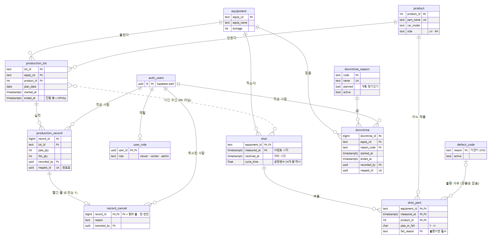
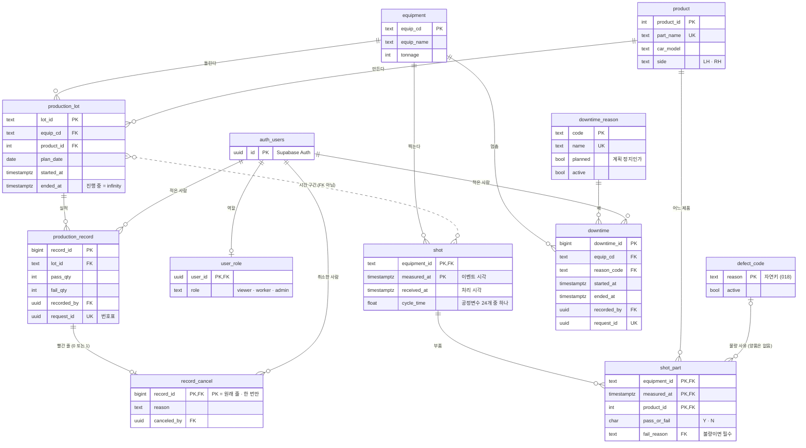

# 스키마 — 한 장으로 보기

> 2026-10-22 · 마이그레이션 `001` ~ `019` 기준 · 스키마의 진실은 `db/migrations/` 다. 이 문서는 지도다.
> 테이블을 바꾸면 이 그림도 같이 고친다.

## ERD

> 위 그림은 아래 mermaid 를 그린 것이다 (GitHub 는 mermaid 를 바로 그린다). 그림을 고치면 mermaid 를 고치고 다시 뽑는다.

## 읽는 법

| 선 끝 | 뜻 |
|---|---|
| `\|\|` | 정확히 하나 |
| `o{` | 0개 이상 여럿 |
| `o\|` | 0개 또는 하나 |
| `\|o` | 없거나 하나 (가리키는 쪽 칸이 NULL 을 허용) |
| 점선 `..` | **FK 가 아닌 관계** — 이 프로젝트에서는 시간 구간 조인 하나 |

- **갈퀴(`{`) 쪽이 N 이고 FK 칸을 가진다.** 화살표는 트랜잭션 → 마스터 (주문서가 메뉴판을 가리킨다)
- `auth_users` 는 Supabase Auth 의 `auth.users` 다. 우리가 만든 표가 아니라 그림에서 이름을 바꿨다

## 마스터와 트랜잭션

| 구분 | 테이블 | 고치기 | 지우기 |
|---|---|---|---|
| 마스터 | `equipment` · `product` | 화면에서 안 연다 (가리키는 곳이 많다) | 없음 |
| 마스터 | `downtime_reason` · `defect_code` | admin 만 (019) — 사용 중지 | 없음 |
| 마스터 | `user_role` | SQL Editor 로만 | 사용자와 같이 (CASCADE) |
| 트랜잭션 · 기계 | `shot` · `shot_part` | 수집기 upsert (같은 샷은 같은 내용) | 없음 |
| 트랜잭션 · 사람 | `production_record` · `record_cancel` · `downtime` | 아무도 못 고친다 — 취소 후 재등록 | 없음 |
| 애매 | `production_lot` | 계획이면서 시간 구간 — EXCLUDE 로 겹침 금지 | 없음 |

## 🔵 그림에 보이는 설계 결정

- **`production_lot` 과 `shot` 사이에 FK 가 없다.** 설비는 LOT 을 모른다. 조인은 항상
  `equip_cd = equipment_id AND measured_at ∈ [started_at, ended_at)` 로 한다 — [ADR 001](decisions/001-시간구간-조인-구조.md)
- **`record_cancel` 이 `production_record` 와 1:0..1** — PK 가 원래 줄 번호라서 한 줄은 한 번만 취소된다 — [ADR 014](decisions/014-취소와-정정.md)
- **`shot_part` 의 PK 가 세 칸** (설비 · 시각 · 제품) — 패밀리 금형이라 한 샷에 부품이 여럿 — [ADR 005](decisions/005-샷과-부품-분리.md)
- **`defect_code` 는 자연키** — `fail_reason` 글자 그대로가 FK. 이름 바꾸기는 `ON UPDATE CASCADE` (018)
- **사람이 쓰는 표에는 `recorded_by` · `request_id` 가 있다** — 누가 썼나 · 같은 제출은 한 줄 ([ADR 013](decisions/013-인증과-인가.md))

## 이름 붙인 제약 (구간 · 관계)

| 제약 | 표 | 막는 것 |
|---|---|---|
| `lot_no_overlap` | production_lot | 같은 설비 · 제품의 LOT 구간 겹침 (EXCLUDE) |
| `lot_qty_sum` · `lot_time_order` | production_lot | 양품 + 불량 ≠ 생산 · 끝 ≤ 시작 |
| `record_qty_positive` | production_record | 0 + 0 |
| `part_fail_has_reason` | shot_part | 불량인데 사유 없음 |
| `part_fail_reason_known` | shot_part | 명단에 없는 불량 사유 (FK) |
| `downtime_no_overlap` | downtime | 같은 설비의 비가동 겹침 (EXCLUDE) |
| `downtime_time_order` · `downtime_not_future` | downtime | 끝 ≤ 시작 · 끝이 미래 |

전부 일부러 어겨본 결과는 [`evidence/constraints-reject.md`](evidence/constraints-reject.md) 에 있다.

## View · 함수

| 이름 | 종류 | 하는 일 |
|---|---|---|
| `equipment_summary` · `plant_summary` | View | 현황판 집계 — `shot_part` 원본에서 센다 (010) |
| `daily_yield` · `defect_pareto` | View | 품질 화면 |
| `active_record` | View | 취소되지 않은 실적만 (014) |
| `get_lot_shots(lot_id)` | RPC | LOT 의 시간 구간으로 샷을 잇는다 (005) |
| `correct_record(…)` | RPC · INVOKER | 정정 = 취소 + 새 줄을 한 트랜잭션으로 (015) |
| `app_role()` | 함수 · DEFINER | 내 역할 — 정책 ↔ 명단의 재귀를 끊는다 (011) |

View 는 전부 `security_invoker = true` — 부른 사람의 RLS 를 지난다 (ADR 008).
